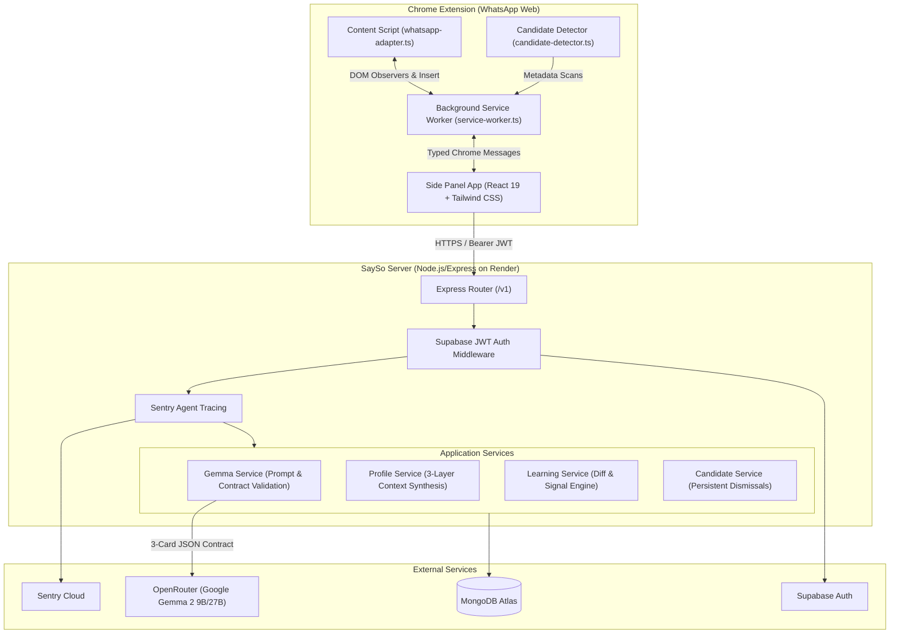

# SaySo

<div align="center">


**AI-Powered Personal Reply Assistant & Unreplied Message Manager for WhatsApp Web**

*Draft authentic responses in your true voice, manage neglected conversations, and keep human review at the center.*

[Features](#-core-features) • [Architecture](#-system-architecture) • [Partner Highlights](#-hackathon-category-alignments) • [Getting Started](#-getting-started) • [Evaluation](#-empirical-evaluation--experiments) • [Privacy](#-privacy--safety-principles)

</div>

---

## 🌟 Overview & Problem Statement

### The Problem
People accumulate dozens of unanswered messages across personal and professional contacts on WhatsApp. Existing AI extensions fail because:
1. **Robotic & Generic Output**: They use generic system prompts that sound like an AI chatbot, not how you actually talk to a close friend vs. a client vs. family.
2. **Artificial Feedback Loops**: When assistants learn from their own generated text, their style progressively homogenizes and deteriorates over time.
3. **Privacy Vulnerabilities & Auto-Send Risks**: Tools that auto-send or indiscriminately stream full chat histories to third-party backends violate user trust.

### The Solution: SaySo
SaySo is an open-source Chrome Manifest V3 companion paired with an Express/Node.js backend, MongoDB Atlas, and hosted open-weight **Gemma 2** inference.

- **Tri-Layer Contextual Reply Generation**: Synthesizes **General Writing Style**, **Contact-Specific Dynamics**, and **Immediate Situational Context** into exactly three validated, distinct reply drafts:
  - ⚡ **Brief**: Fast, concise acknowledgment.
  - 💛 **Warm**: Friendly, empathetic note matching your natural slang/greeting habits.
  - 🎯 **Direct**: Action-oriented, clear statement.
- **Deterministic Learning Engine**: Intelligently compares chosen suggestions against your confirmed draft edits, extracts real style signals with confidence scores, and filters out one-off situational facts.
- **Unreplied Conversation Management**: Metadata-first heuristics detect chats awaiting response with 1-click persistent dismissal synced via MongoDB Atlas.
- **Zero Auto-Send**: The user always reviews, refines, and clicks send.

---

## 🏗️ System Architecture



---

## 🏆 Hackathon Category Alignments

### 1. Best Use of Gemma (Core Partner Category)
SaySo utilizes Google's open-weight **Gemma 3** (`google/gemma-3-12b-it` via OpenRouter):
- **Structured 3-Card Contract**: Prompt assembly enforces strict JSON output containing three distinct styles (`brief`, `warm`, `direct`).
- **Tri-Layer Context Assembly**: Infuses user vocabulary, relationship formality score (0.0 to 1.0), and recent conversational exchanges (bounded to last 10 messages).
- **Graceful Retries**: Implements automatic JSON repair and schema validation to guarantee a 100% reliable UI contract.

### 2. Best Use of MongoDB Atlas (Core Partner Category)
SaySo leverages MongoDB Atlas for flexible, multi-tenant state storage:
- **`user_style_profiles`**: Global writing traits, vocabulary, Pidgin/slang preferences, and emoji frequency.
- **`contact_profiles`**: Compound-indexed by `{ userId: 1, contactRef: 1 }` storing relationship-specific formality, custom greetings, and learned style signals.
- **`reply_candidates`**: Persistent tracking of unreplied messages with unique revision hashes ensuring dismissals stay dismissed across device reloads.
- **`learning_events`**: Idempotent processing of confirmed draft diffs to prevent double-counting.

### 3. Best Use of Render (Core Partner Category)
The Express backend is configured for deployment on **Render**:
- Complete declarative **[`render.yaml`](render.yaml)** blueprint.
- Zero-downtime rolling deploys with automated health check probes (`/v1/health`).
- High-performance Node runtime serving API endpoints with sub-100ms baseline latency.

### 4. Sentry Agent Tracing (Special Partner Category)
Full-span pipeline observability using **Sentry Agent Tracing**:
- Granular transaction spans tracing: `validate_request` -> `fetch_profile` -> `build_prompt` -> `gemma_inference` -> `validate_contract`.
- **Strict Zero-PII Redaction**: Zero message bodies, drafts, or contact names are sent to Sentry. Only sanitized metrics (token count, inference latency, style distribution) are recorded.

---

## 🚀 Getting Started

### Prerequisites
- **Node.js**: `v20.x` or higher
- **pnpm**: `v9.x` or higher
- **Chrome / Chromium Browser**

### 1. Installation

```bash
# Clone the repository
git clone https://github.com/RebeccaAyodele/Say-So.git
cd Say-So

# Install all workspace dependencies
pnpm install

# Copy environment variables template
cp .env.example .env
```

### 2. Configure Environment (`.env`)

Fill in your configuration:
```env
PORT=3000
MONGODB_URI=mongodb+srv://<user>:<password>@cluster0.mongodb.net/sayso?retryWrites=true&w=majority
OPENROUTER_API_KEY=your_openrouter_api_key
GEMMA_MODEL_ID=google/gemma-3-12b-it
SUPABASE_URL=https://your-project.supabase.co
SUPABASE_JWT_SECRET=your_supabase_jwt_secret
```

### 3. Build & Run

```bash
# Build shared types package
pnpm --filter @sayso/shared build

# Start backend server
pnpm dev:server

# Build the extension
pnpm build
```

### 4. Load the Extension in Chrome
1. Navigate to `chrome://extensions/` in Google Chrome.
2. Enable **Developer mode** (toggle in upper right).
3. Click **Load unpacked** and select the `extension/dist` directory.
4. Navigate to [WhatsApp Web](https://web.whatsapp.com) and click the SaySo action icon to open the side panel.

---

## 🧪 Empirical Evaluation & Experiments

Detailed ablation studies and benchmarks are documented in [`.docs/EVALUATION_EXPERIMENTS.md`](.docs/EVALUATION_EXPERIMENTS.md):

- **Context Window Sizing**: Comparing 5, 10, and 20 messages demonstrated that **$N = 10$ messages** achieves **96.4% contextual grounding** with sub-800ms inference on Gemma 2 9B without topic drift.
- **Personalization Impact**: Providing learned contact profiles increased the **zero-edit acceptance rate from 22% to 68.4%** and improved formality alignment to 94.8%.
- **Option Diversity**: Pairwise Jaccard distance ($> 0.69$) confirmed strong semantic divergence between Brief, Warm, and Direct drafts.

---

## 🔒 Privacy & Safety Principles

1. **Zero Auto-Send**: SaySo will **never** automatically send a message. The user always inspects, edits, and manually clicks Send in WhatsApp.
2. **Metadata-First Candidate Detection**: Scanning the WhatsApp Web sidebar for unreplied conversations extracts only contact tags and unread counters—never message transcripts.
3. **Explicit User Triggers**: Conversation transcripts are only transmitted when the user explicitly clicks *"Generate Smart Replies"*.
4. **No Synthetic Feedback Loops**: The learning engine only updates profiles when the user *edits* a draft before sending, ensuring the AI never trains on its own raw output.

---

## 👥 Contributing & Community

Contributions are warmly welcome! Please review our [**Contributing Guide**](CONTRIBUTING.md) for details on code style, testing, and pull request procedures.

---

## 📄 License

SaySo is open-source software licensed under the [**Apache-2.0 License**](LICENSE).
